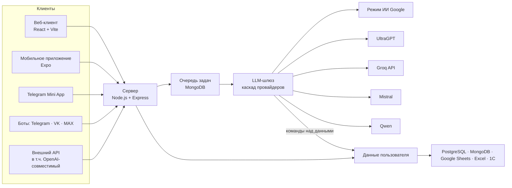

# Siberi AI — платформа ИИ-ассистентов с собственным LLM-шлюзом

SaaS-платформа, на которой человек или бизнес за несколько минут получает своего ИИ-ассистента. Ассистент знает данные владельца, умеет не только читать их, но и **записывать**, и работает там, где нужно: в Telegram, VK и MAX, на сайте, в мобильном приложении и через API. Ботов собирают промптами, без единой строки кода.

Спроектирована и написана в одиночку, фулл-стек. Работала в продакшене на siberi.online с платными тарифами. Около 77 000 строк кода: сервер, веб-клиент, мобильное приложение и Telegram Mini App.

## Возможности

- **Пространство данных.** У каждого пользователя свои схемы и записи, синхронизация с PostgreSQL, MongoDB, Google Sheets, Excel и 1С.
- **ИИ записывает в данные.** Модель отвечает текстом и структурированными командами (`DB`, `UPSERT`, `PATCH`, `DELETE`, `NOTIF`, `BOT`). Сервер их проверяет и исполняет: «запиши клиента на пятницу в 15:00» — запись в базе и уведомление владельцу.
- **Конструктор ботов промптами.** Меню, интерфейс, триггеры, уведомления Telegram-бота задаются словами. Есть готовые шаблоны по нишам: клиника, барбершоп, доставка, автосервис, блог и другие.
- **Каналы.** Telegram, VK, MAX, веб-виджет со встраиванием по токену, Telegram Mini App, мобильное приложение на Expo.
- **Внешний API.** Асинхронный `POST /api/v1/ai/generate` → `taskId` → `GET /api/v1/ai/result/:taskId` и OpenAI-совместимый `POST /api/v1/ai/chat/completions` — любой клиент OpenAI SDK подключается без переделок.
- **Монетизация.** Тарифы, ЮMoney и Т-Банк с рекуррентными платежами, партнёрская программа, роли creator / admin / user.
- **Вход.** Почта, Google, Яндекс, VK.

## LLM-шлюз — где здесь ИИ-инженерия

| Задача | Как решено |
| --- | --- |
| Один провайдер — одна точка отказа | Каскад: режим ИИ Google → UltraGPT → Groq API (`openai/gpt-oss-120b`) → пул вкладок Mistral → резерв Qwen. Ярусы включаются переменными окружения, ошибка любого молча передаёт задачу следующему |
| Мёртвый провайдер держит очередь | У каждого яруса свой таймаут на первые символы ответа: не начал отвечать за 25 с — ход следующему, а не ожидание общего дедлайна |
| Генерация дольше лимитов HTTP-запроса | Асинхронный API на задачах в MongoDB: клиент получает `taskId` и опрашивает результат. Частичный ответ пишется в задачу по мере генерации, интерфейс показывает текст вживую |
| Холодный старт браузерного провайдера | Тёплые вкладки держатся заранее: запрос забирает готовую, на её место в фоне готовится новая. После ответа своя цепочка удаляется из истории аккаунта по её id |
| Быстрая модель ненадёжна в записи данных | Dual-track для Telegram-ботов с записью в базу: пользователю мгновенно отвечает Groq, а более аккуратная модель в фоне проходит тот же диалог и исполняет команды над данными |
| Ответ модели бывает «грязным» | Нормализация разметки (двухпроходный препроцессор Markdown), срез интерфейсного мусора провайдеров, разбор команд с валидацией перед исполнением |
| Злоупотребления | Rate limiting, лимиты генераций по тарифу, helmet, ключи API с авторизацией на внешнем API |

## Архитектура



| Путь | Что внутри | Объём |
| --- | --- | --- |
| `server/` | Express: LLM-шлюз (`AiService.js`) и браузерные драйверы провайдеров (`services/`), маршруты API, конструктор ботов, интеграции, оплата, уведомления, тесты | ~29 000 строк |
| `client/` | Веб-клиент на React + Vite: лендинг, кабинет, чат, данные, интеграции, студия ботов, админка | ~36 600 строк |
| `mobile/` | Мобильное приложение на Expo (React Native) | ~3 000 строк |
| `webapp/` | Telegram Mini App | ~8 400 строк |
| `deploy/` | Nginx, PM2, скрипты установки и выкладки | |
| `docs/` | [PRODUCT.md](docs/PRODUCT.md) — функции, архитектура и API; [CHANGELOG.md](docs/CHANGELOG.md) | |

## Стек

**ИИ:** каскад LLM-провайдеров с фолбэком, Groq SDK, браузерные драйверы на Playwright по CDP, асинхронная очередь генераций, стриминг частичных ответов, структурированные команды модели.
**Бэкенд:** Node.js, Express, MongoDB (Mongoose), PostgreSQL (`pg`), Telegraf, Google APIs, разбор DOCX, PDF и XLSX, nodemailer.
**Фронтенд:** React, Vite, React Router; React Native (Expo) для мобильного приложения.
**Инфраструктура:** Nginx, PM2, Linux-сервер, express-rate-limit, helmet.

## Запуск

Нужны Node.js 20+ и MongoDB.

```powershell
copy .env.production.example server\.env   # MONGO_URI, ADMIN_SECRET и ключи нужных провайдеров
cd server; npm install; cd ..\client; npm install; cd ..
npm install
npm run start:all                           # сервер и веб-клиент разом
```

Браузерным провайдерам нужен Microsoft Edge: сервер сам поднимает его с отдельным профилем, в котором один раз выполняется вход в аккаунт провайдера. Профили браузера в git не попадают. Без них шлюз работает на API-провайдерах (Groq).
